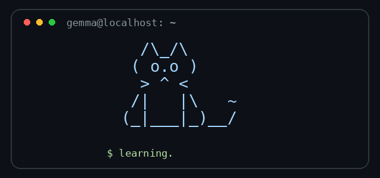

  

Software Engineering Student · Builder · Lifelong Learner

Background:

I'm a Software Engineering - PFIEV student at the Da Nang University of Science and Technology, Viet Nam.

I enjoy turning ideas into practical software — from designing interfaces to building applications with modern web technologies.

🌱 Currently Learning

▸ Writing cleaner and more maintainable code 
▸ Improving backend development skills 
▸ Building modern web applications 
▸ Exploring AI integration in software products 
▸ Software Testing 
▸ Artificial Intelligence & Machine Learning 
▸ Cybersecurity 
▸ DevOps & Cloud Computing 
▸ System Monitoring

Engineering Mindset

Tinker → Learn → Build → Break → Debug → Improve → Repeat

I believe good software is not only about making something work,
but also about making it understandable, maintainable and useful.

✨ Code with curiosity. Build with purpose.

  
  
  

